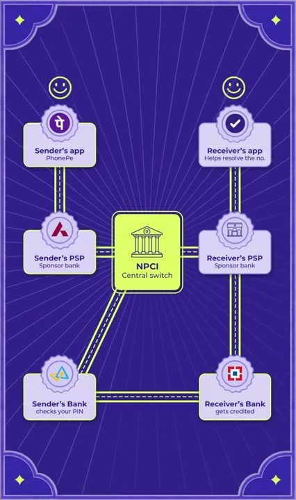
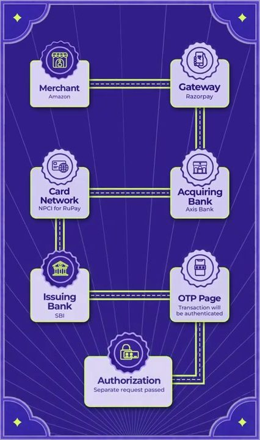

[Nikhil Kamath](https://x.com/nikhilkamathcio)'s latest WTF episode is four hours discussion on payments. He invited Sameer Nigam of [PhonePe](https://www.phonepe.com), [Harshil Mathur](https://x.com/harshilmathur) of [Razorpay](https://razorpay.com) and Sohini Rajola of [NPCI](https://www.npci.org.in) and drives a fascinating conversation on payments in India. I pay for almost everything with [UPI](https://en.wikipedia.org/wiki/Unified_Payments_Interface) and nobody charges me for it, so who is paying? Currently, the Indian government also moved to regulate and also try charging UPI. So I ran the explainer tool I have after pulling the transcripts and turned the episode into a long visual page and explainer whose link is shared below.

## Following one ₹100 payment

The most useful part for me was the hour where they trace flowchart for a single ₹100 transfer through the system. PhonePe never touches your money in this cycle. It sends an instruction to its sponsor bank, called the PSP bank. The sponsor bank passes it to NPCI, the central switch. NPCI asks your bank to check your PIN and debit you, and the receiver's bank credits the other side. Harshil counted roughly ten API calls for one payment, all within milliseconds.

<figure style="margin:28px auto;text-align:center;max-width:100%;">
  
  <figcaption style="margin-top:8px;color:#5b5b55;font-size:14px;text-align:center;">The UPI chain as it was drawn in the episode, at 55:31. From the <a href="/explainers/wtf-is-payments/#screens" target="_blank" rel="noopener">explainer</a>.</figcaption>
</figure>

There is a reason the sponsor bank sits in the middle. The regulator did not want NPCI exposed directly to hundreds of apps it knows nothing about, so every app has to come in through a bank.

## So who pays

The answer they gave is that your bank pays. A ₹100 transfer costs the system about 25 basis points in total. The sender's bank pays the app's sponsor bank somewhere between 15 and 50 paise per transfer, capped at 50 paise, and that money pays for fraud checks, servers and settlement. PhonePe alone runs about 30,000 servers. Banks accept the cost because UPI saves them branch, ATM and cash handling costs, and the money stays in their accounts for longer.

The other thing I hadn't really understood is that the "success" screen is not the money moving. It is an entry in a ledger. The banks net out what they owe each other and settle through their RBI accounts about ten times a day. Sohini said around 100 million payments at peak shrink to roughly 800 settlement entries.

## Where the Panel debated the most

This was not a friendly panel on every point. Sameer and Harshil both argued that zero MDR, the rule that merchants pay no fee on UPI, starves the private companies that built the rails. They were also against the proposed 30% market-share cap on UPI apps, which they see as punishing whoever wins. Sohini held NPCI's line that this is critical public infrastructure and that too much scale in one app is itself a risk. Nobody conceded anything. Nikhil's view was that both sides have a point and there has to be some equilibrium and balance. It was most refreshing to see this debate between regulatory pro and against pro parties.

## Cards work very differently

The card section explained some gyan that a lot of us may not know. When Amazon takes a credit card payment through Razorpay it pays about 1.85%. Razorpay keeps around 10 basis points. About 1.45% goes to the bank that issued the card, to pay for the interest-free period and the rewards. That is why banks compete on rewards for us and not on price for merchants. Harshil also explained why gateways charge a percentage and not a flat fee. If a merchant takes the money and disappears, the gateway owes the refunds, so the fee is priced on risk.

<figure style="margin:28px auto;text-align:center;max-width:100%;">
  
  <figcaption style="margin-top:8px;color:#5b5b55;font-size:14px;text-align:center;">The card flow from the episode, at 1:43:53: merchant, gateway, acquiring bank, card network, issuing bank, then the OTP page and authorization.</figcaption>
</figure>

## What the payment data says about India

Sameer had interesting numbers from PhonePe's data in the podcast. Tier 2 cities and smaller towns make up 65–70% of digital payments. Harshil added that 70% of e-commerce spend still comes from about 15 million users. When GST was cut by 2–5% on some categories, spending in those categories went up 5.5–13%, and the categories that weren't cut moved by −0.2%. Harshil explained cash on delivery as a trust problem. New online shoppers pay cash because they are not sure the goods will arrive.

## Agents that pay

Near the end they got to AI agents paying for things, which is the part closest to my own work. Harshil thinks agents will shop differently from us because they have time, read every word and can negotiate with other agents, so checkout should be built for them now. Sameer thinks the token cost makes it uneconomic today. NPCI says it is building a framework for agent payments on UPI. In the second segment, three younger founders from Seven, [Dodo Payments](https://dodopayments.com) and [PayGlocal](https://www.payglocal.in) talked about payment rings, cross-border payments and agent fraud, and they thought mass adoption of agent payments in India is still a few years away.

## The visual explainer

The page has every section of the episode with a short summary per beat, a plain-English note for the jargon, 77 quotes pinned to their timestamps, the key numbers, the debates, and the diagrams they showed on screen. The full captions are under each section. Speaker names are my best guess from the flow of the conversation, because the captions don't say who is talking. The guesses are weakest in the stablecoin and market-cap exchanges and in parts of the second segment. The numbers are as they were said on the show, and I haven't checked them against other sources.

  <a href="/explainers/wtf-is-payments/" target="_blank" rel="noopener"
     style="display:inline-block;background:#c2410c;color:#fff;padding:14px 18px;border-radius:7px;font-weight:600;text-decoration:none;border:0;font-size:16px;">
    Open the WTF is Payments explainer &rarr;
  </a>
   
  <small style="color:#5b5b55;">Opens in a new tab. Every timestamp links back to the original video.</small>

If you have four hours, watch the [full episode on YouTube](https://www.youtube.com/watch?v=hBvInWQWpZ0). It is one of the best one Nikhil ever hosted on WTF platform.
